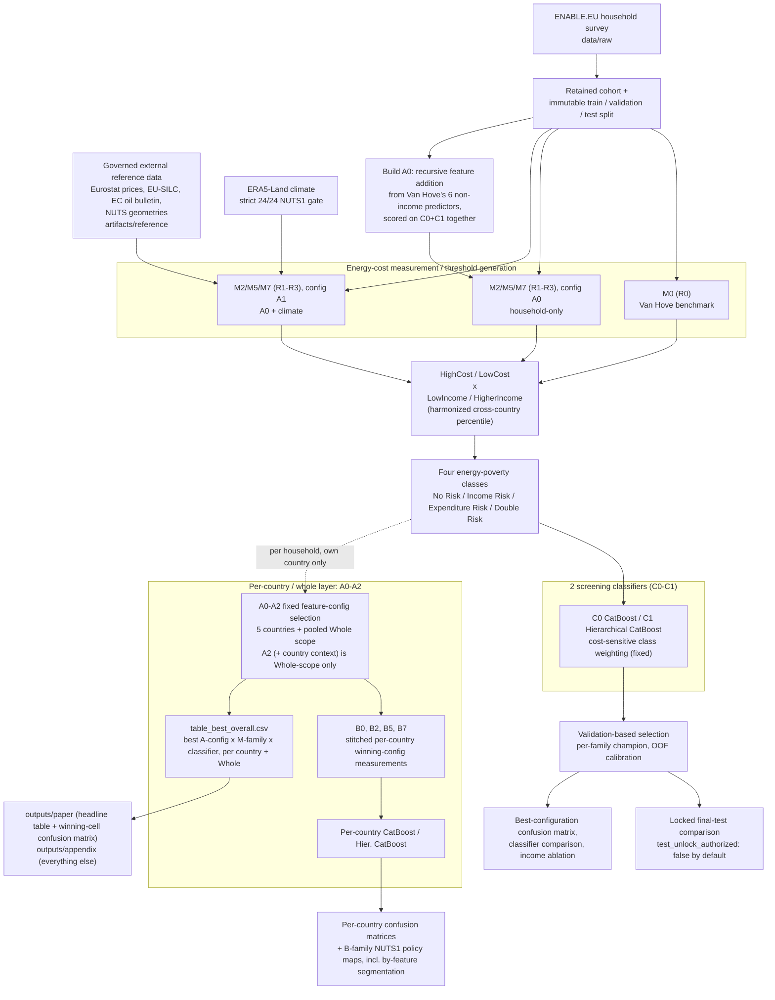

Energy-poverty measurement redesign
====================================

This project asks a social-science question with machine-learning tools: **which
observable household and dwelling factors are associated with energy poverty, and
does that association differ by country?** Screening classifiers are the
measurement instrument for that question, not the deliverable -- a classifier's
job here is to test how well a given energy-poverty definition can be
reconstructed from observable household characteristics, so that SHAP/feature
analysis on top of it tells you which factors actually carry the signal.

Two benchmarks anchor the comparison: **M0**, a direct replica of Van Hove et al.'s
country-Q80-on-raw-expenditure benchmark, and **M2/M5/M7**, three genuinely
different regression methods (linear quantile regression / GAM / gradient-boosted
quantile regression) that instead model each household's *conditional* high-cost
threshold from its own dwelling and composition. See
`AUDIT_AND_REPAIR_REPORT.md` for the full reproducibility audit trail.

Skeleton created 2026-08-11 (see git tag `legacy-before-measurement-redesign-20260811`
for the prior codebase). Major redesign 2026-08-26: predictor selection, model
suite, and reporting layer rebuilt around the goal above -- see "What changed on
2026-08-26" below if you're picking this up mid-transition.

Pipeline overview
------------------



Symbol legend
-------------

Figures and tables use short paper-facing codes instead of full internal names
(`lib/reporting/codes.py`, `outputs/tables/table_symbol_legend.csv`):

| Code | Meaning |
|---|---|
| **R0** | M0 -- Van Hove country-Q80 benchmark |
| **R1-R3** | M2 / M5 / M7 -- linear quantile regression / GAM / gradient-boosted quantile regression, each at its own OOF-calibrated quantile |
| **C0-C1** | CatBoost / Hierarchical CatBoost (the third classifier, ARM-Net, was removed -- see below) |
| **A0** | This project's standard predictor set: Van Hove's 6 non-income predictors + whatever else a recursive search finds actually helps (`scripts/build_a0_predictor_selection.py`) |
| **A1** | A0 + climate (HDD/CDD/temperature/frost days) |
| **A2** | A1 + country economic context (price/income/rent/tenure) -- Whole scope only |

Combo naming: `A{config}R{regression}C{classifier}`, e.g. `A0R2C1` = config A0,
regression method R2 (M5, GAM), classifier C1 (Hierarchical CatBoost). Generate the
legend table with `python scripts/build_symbol_legend.py`.

How A0 (the predictor set) is built
------------------------------------

Rather than hand-picking a feature list, `scripts/build_a0_predictor_selection.py`
runs a **recursive (forward) feature-addition search**:

1. Start from Van Hove et al.'s 6 non-income predictors (floor area, household
   size, dwelling detachment, dwelling age, respondent age, heating strategy) --
   their 7th predictor, income bracket, is deliberately excluded (see "Why income
   is excluded" below).
2. At each step, try adding every remaining candidate feature (the full engineered
   household set only -- climate and country context are added later, as A1 and
   A2, never as A0 candidates) one at a time; fit **both** C0 and C1 with it
   added; keep whichever single candidate improves their averaged validation
   macro-F1 the most.
3. Repeat until no candidate improves the score by more than a small tolerance.
4. Write the winning list into `config/pipeline.json`'s `features` key -- this
   becomes A0, used identically everywhere in the pipeline (pooled and
   per-country). One shared predictor set means "the effect of factor X" means
   the same model term in every country -- the reason A3/A4 (the old per-country
   auto-selected configs) were removed.

`scripts/audit_vanhove_replication.py` runs alongside this as a separate sanity
check: it fits Van Hove's *exact* 7-predictor design, income included, to verify
this project's data/labels reproduce their reported result (accuracy > ~71%) when
using their own methodology -- confirming any gap in the production (income
-excluded) numbers is a deliberate design choice, not a modelling defect.

Why income is excluded
------------------------

Van Hove's own design includes income bracket as both half the label (the "low
income" axis) and a predictor -- they say so explicitly, and note that a
classifier given income can nearly perfectly relearn that half of the four-class
problem, leaving the *other* predictors to only separate the two harder
sub-problems (Double Risk vs. Income Risk within low income; Expenditure Risk vs.
No Risk within higher income). This project's actual question -- which
observable factors identify at-risk households -- is not well served by a
predictor that can trivially reconstruct the label. Income is therefore excluded
from every production predictor set and enforced absent by test
(`tests/test_governance.py`); `scripts/compare_income_ablation.py` is the one
deliberate exception, quantifying how much of any performance gap against Van
Hove's published number is this shortcut rather than genuine signal in the other
predictors.

Income-bracket harmonization
-------------------------------

ENABLE's income question uses country-specific, undocumented-in-EUR ordinal
brackets (10-12 categories depending on country). A flat `bracket <= 3` rule
applied the same way in every country produced a "low income" share ranging from
22% to 80% across countries -- a bracket-scale artifact, not a real income
difference. `lib/labels/income_harmonization.py` fixes this: each household's
bracket is converted to a country-normalized percentile (bracket k of that
country's own N categories -> the `[(k-1)/N, k/N)` population slice), so
"low income" means the same relative standing in every country.

What changed on 2026-08-26
-----------------------------

A large restructuring, in one place for anyone picking this up mid-transition:

- **Predictor set is now built, not hand-listed** -- see "How A0 is built" above.
- **M3/M4/M6/M8 removed.** An empirical correlation audit found their predictions
  correlated 0.86-0.98 (Spearman) with the retained M2/M5/M7 trio -- redundant
  evidence, not independent methods, given the shared ~0.15-0.23 R² ceiling on
  this data. See `measurement/families/model_based/estimators.py`'s docstring.
- **ARM-Net removed.** Statistically indistinguishable from CatBoost/Hierarchical
  CatBoost on macro-F1, worse-calibrated on log-loss, no SHAP-native
  interpretation path.
- **The H/HC and \*_BASE feature-ablation axes are gone**, folded into the single
  A0 -> A1 -> A2 staged config: A1 is what "HC" used to mean, and the *_BASE
  ablation is superseded by the recursive search itself, which measures each
  feature's marginal value directly instead of a crude enriched-vs-base
  comparison.
- **cost_sensitive/balanced_bootstrap/SMOTENC removed as a compared axis.**
  Cost-sensitive class weighting is now the single fixed imbalance-handling
  method everywhere, chosen because it needs no synthetic data and works even on
  small per-country groups (e.g. Spain's Double Risk class, ~2% prevalence).
- **Confusion matrices are generated only for the single best configuration**, not
  one grid per measurement x classifier x stage.
- **New reporting layer**: Nightingale (stacked polar area) charts for regression/
  classification/SHAP metrics, a two-state (income-excluded vs. included)
  threshold scatter, and policy maps segmented by household factor (dwelling
  type, heating fuel, respondent gender, settlement type) -- see below.
- **A0/A1/A2 de-duplicated via `stack_features()`.** The recursive search
  legitimately picked `ctx_gas_price`, `frost_days`, and `temperature_mean` into
  A0 because they helped C0/C1 -- but those same columns also live in
  `climate_features`/`CONTEXT_COLUMNS`, so a plain `A0 + climate_features` (A1)
  or `A1 + CONTEXT_COLUMNS` (A2) concatenation would pass a duplicate column
  name into the model matrix and break `pd.api.types.is_numeric_dtype`.
  `lib/features/household_features.py`'s `stack_features()` de-duplicates,
  order-preserving, and every A1/A2 construction site now goes through it.
  Also fixed a matching bug this exposed in `build_evaluation_summary.py`'s
  Adjusted-R² predictor count, which compared `feature_config == "H"` -- a
  string that stopped existing once champions were tagged `"A0"`/`"A1"`, so it
  silently over-counted predictors for every A0 champion.
- **`scripts/build_comparison_cohorts.py` removed.** Orphaned by the same
  restructuring: it hardcoded now-nonexistent `m{family}_h.parquet` prediction
  paths from the retired H/HC naming, wasn't called by `run_full_pipeline.sh`,
  and nothing downstream consumed its `common_four_class_cohort*.parquet`
  output. `data/cohorts.py`'s underlying `common_comparison_uids`/
  `method_native_uids` helpers are untouched and still unit-tested.

Study design (decided 2026-09-19)
---------------------------------

Base: Van Hove, Dalla Longa & van der Zwaan (2022), *Energy & Buildings* 264:112064 -- the same ENABLE.EU survey,
the same four "income x expenditure" classes, CatBoost + SHAP. Extensions: a need-based cost threshold, an explicit
universal-vs-contextual test, honest uncertainty, and a policy (targeting-error) layer. Target venue: *Energy Policy*.

| Decision | Choice |
|---|---|
| Countries | Bulgaria, Hungary, Italy, Poland enter every stage; **Spain is dropped** from the per-country four-class stages (21 Double-Risk households < 30, and 6 of 8 factor cells estimable). Rule: `viability()` in `lib/identification/labels.py`. |
| Income axis | **Headline: Van Hove's fixed rule, bracket <= 3.** Sensitivities: frozen percentile <= 0.30, and two DYNAMIC rules (household-size-adjusted / residual-after-energy-cost income below 60% of the national median). `scripts/build_identification_sensitivity.py` |
| Cost axis | **Headline: need-based threshold** (per-country regression on floor area, size, dwelling, climate; out-of-fold). Van Hove's country Q80 is the benchmark/replication. |
| Income as predictor | **Both states**: excluded (proxy targeting) and included (Van Hove's design). |
| Importance | mean\|SHAP\|, permutation importance and partial dependence, on held-out CV folds (Van Hove found SHAP and permutation can disagree). |
| Evaluation | Repeated 5-fold CV over train+validation with household-bootstrap 95% CIs; chance baseline; **every metric**: accuracy, balanced accuracy, precision, recall, specificity, F1, ROC-AUC, PR-AUC, MCC, kappa, log-loss, Brier, per class and per axis (`lib/identification/metrics.py`). The locked test partition is untouched (unlock once, at the end, if at all). |

Flow, one scatter figure per step (`scripts/build_step_scatter_figures.py`):
1. cost threshold -> `step1_cost_threshold`; 2. income x cost quadrants -> `step2_income_cost_quadrants`, `step2b_income_dynamic_vs_static`;
3. predictor discovery, universality, PDP -> `scripts/build_predictor_discovery.py` (`discovery_*`);
4. classification of the four classes -> `scripts/build_identification_benchmark.py`, `step4_prediction_space`;
5. cross-country factor comparison -> `scripts/build_factor_comparison.py`;
6. **Managerial implications** -> `scripts/build_managerial_implications.py`: missed vs wrongly-included households per 1,000, by information tier and country
   (`table_managerial_*`, `managerial_targeting_frontier`, `managerial_errors_per_1000`).
Credibility check against the base paper: `scripts/replicate_vanhove_importance.py`.

Identification-accuracy audit (2026-09-19)
-------------------------------------------

Why the per-country macro-F1 was weak (0.27-0.43, Spain 0.23-0.40), found by auditing the labels
and the evaluation rather than tuning models:

1. **Partition-dependent income label (bug, fixed).** The v1 low-income rule computed N = max(bracket)
   over whichever rows it was given, so the cutoff moved between train/validation/test. Spain's
   bracket 3 was low-income in validation/test but not train (v1 low-income share: 5.0% in train,
   7.9% validation, 17.7% test), leaving **1 Double-Risk household in Spain's training set**. It also assumed equal-mass
   brackets: Hungary came out 72% low-income, Spain 10%. Now a frozen survey-weighted empirical
   bracket->percentile table (`scripts/build_income_bracket_reference.py`,
   `artifacts/reference/income_bracket_percentiles.csv`) gives 22-42% everywhere and identical labels
   in every partition. Audit: `outputs/tables/table_income_label_shift_audit.csv`.
2. **H2 "don't know" (99) was fed to the models as the number 99** (5.8-14.7% of households); now NaN
   in `engineer()` (same for H1 == 9).
3. **The expenditure axis was unlearnable by construction.** R1-R3 thresholds condition on the same
   features the classifier sees, so the label is ~independent of its inputs (pooled AUC 0.51). The
   identification labels now use a *need-only* threshold (floor area, size, dwelling, HDD/CDD).
4. **Tiny validation sets, winners picked on noise.** Per-country validation had 63-164 households.
   `lib/identification/` scores everything with repeated 5-fold CV over train+validation (test stays
   locked), household-bootstrap 95% CIs and a random-prior chance floor (~0.23-0.26 macro-F1).
5. **Some claims are not supportable.** `table_identification_support.csv` gates each country: Spain has
   21 Double-Risk households (< 30), so its four-class per-country result is withdrawn; Spain is
   reported on the two binary axes and via the pooled model.

`scripts/build_identification_benchmark.py` -> `table_identification_{support,benchmark,headline}.csv`:
information tiers T1 structural / T2 + socio-economic / T3 + welfare screen (S7 bill aid, S8 subjective
income adequacy) x models x local / pooled / leave-one-country-out. Income itself stays excluded.
`scripts/build_factor_comparison.py` links interpretation to accuracy (solid-fuel, dwelling age, elderly,
household size; climate as moderator): `table_factor_{effects,heterogeneity,pairs,triples,
accuracy_contribution}.csv`, `table_country_link.csv`, four `factor_*`/`country_transfer_link` figures.
`scripts/build_hardship_target_check.py` tests a policy-anchored target (self-reported hardship, S8 >= 3).

**Not yet regenerated:** every artifact produced before this date (M0 labels, `m*_a0/a1.parquet`,
OOF calibration, the 258-run screening matrix, family champions, per-country layer, B-family, policy
maps) carries the old income labels and H2 coding. They need `bash scripts/run_full_pipeline.sh`
(multi-hour) before their numbers are quoted; the identification tables above do not depend on them.

New diagnostics and reporting
--------------------------------

All read already-computed outputs; nothing here re-fits a model.

- `scripts/build_nightingale_metrics.py` -- three stacked polar-area (Nightingale
  rose) charts: regression metrics by R-code, classification metrics by R-code x
  classifier, and SHAP feature effectiveness by country. Deliberately not a radar
  chart: each wedge is a separated, stacked bar radiating outward, not a
  continuous line web.
  (`outputs/figures/nightingale_{regression_metrics,classification_metrics,shap_features}.png/.pdf`)
- `scripts/build_threshold_scatter_income_states.py` -- the project's single best
  configuration's high-cost threshold plotted against observed cost, points
  coloured by the resulting four-class outcome, in two panel rows: income
  excluded vs. income included. Shows directly how adding income reshapes which
  households cross into each risk class, not just the aggregate prevalence shift.
  (`outputs/figures/threshold_scatter_income_states.png/.pdf`)
- `scripts/build_policy_maps_by_feature.py` -- NUTS1 Double-Risk choropleths
  segmented by household factor (dwelling type, primary heating fuel, respondent
  gender, settlement type), two contrasting categories per factor. This is the
  project's actual headline output: not "how well does the model score" but
  "where does each observable factor matter, and by how much."
  (`outputs/figures/policy_map_by_feature.png/.pdf`)
- `scripts/build_regression_threshold_figures.py` -- per R-code, per country: how
  the fitted high-cost threshold sits against the observed cost distribution.
- `scripts/audit_shap_feature_effectiveness.py` -- SHAP-CatBoost materiality audit
  across A0/A1/A2; flags features below a 1% importance-share threshold as
  pruning candidates (diagnostic only, nothing pruned automatically).
- `scripts/build_scenario_simulation.py` -- what-if four-class prevalence table
  for every (scope, A-config, R-code, C-code) combination.
- `scripts/build_evaluation_summary.py` -- one table joining full regression
  metrics (MAE, MAPE, RMSE, R², Adjusted R², pinball loss, coverage error) with
  full classification metrics (Accuracy, Precision, Recall, F1, ROC-AUC, Log Loss,
  Double-Risk F1/recall, balanced accuracy) per R-code x classifier.
- `scripts/build_swimlane_flowchart.py` / `scripts/build_data_flow_diagram.py` --
  process and data-flow diagrams using the R0-R3/C0-C1/A0-A2 codes.

Running the pipeline
---------------------

All commands run from the project root. Full ordered reference (including the
ERA5/A1 stage and the locked final-test step):
[`docs/running_the_pipeline.md`](docs/running_the_pipeline.md).

```bash
pip install -r requirement.txt

# Run every step below in one command (stops on the first failure):
bash scripts/run_full_pipeline.sh
```

Or step by step, same order as `scripts/run_full_pipeline.sh`:

```bash
# Diagnostics + governed external reference data -- prepare_country_references.py
# hits the live Eurostat API (network required)
python scripts/audit_enable_workbook.py
python scripts/validate_nuts.py
python scripts/prepare_country_references.py
python scripts/prepare_energy_prices.py
python scripts/prepare_heating_oil_prices.py

# Data construction, M0 benchmark, immutable household split
python scripts/build_expenditure_m0.py

# ERA5-Land climate
python scripts/acquire_era5_land.py --configuration annual_2017
python scripts/fuse_era5_nuts1.py --configuration annual_2017

# Build A0 (the standard predictor set) and check it against Van Hove's own design
python scripts/build_a0_predictor_selection.py
python scripts/audit_vanhove_replication.py

# M2/M5/M7, config A0 then A1. Quantile is discovered per family by a continuous
# OOF calibration search, so build_oof_predictions.py runs BEFORE
# run_model_measurements.py.
python scripts/build_oof_predictions.py --feature A0
python scripts/run_model_measurements.py --feature A0
python scripts/build_oof_predictions.py --feature A1
python scripts/run_model_measurements.py --feature A1
python scripts/compare_income_ablation.py

# Screening: C0/C1, cost-sensitive weighting throughout, all 7 M0/A0/A1 measurements
python scripts/run_screening_matrix.py

# Family champions, classifier comparison, best-configuration confusion matrix, freeze
python scripts/select_family_champions.py
python scripts/build_classifier_comparison.py
python scripts/build_confusion_matrices.py
python scripts/freeze_validation_selection.py
python scripts/build_quantile_sensitivity.py

# Gates, manifests, figures/tables
python scripts/check_milestone_gates.py
python scripts/build_pipeline_status.py
python scripts/build_progressive_outputs.py
python scripts/build_four_class_figures.py
python scripts/build_policy_maps.py
python scripts/build_policy_maps_by_feature.py

# Per-country/whole feature-selection layer (A0-A2) and B-family
python scripts/run_percountry_feature_selection.py
python scripts/build_b_measurements.py
python scripts/build_b_confusion_matrices.py
python scripts/build_b_policy_maps.py
python scripts/build_paper_appendix_outputs.py

# Symbol legend and paper-facing diagnostics
python scripts/build_symbol_legend.py
python scripts/build_regression_threshold_figures.py
python scripts/build_threshold_scatter_income_states.py
python scripts/audit_shap_feature_effectiveness.py
python scripts/build_scenario_simulation.py
python scripts/build_evaluation_summary.py
python scripts/build_nightingale_metrics.py
python scripts/build_swimlane_flowchart.py
python scripts/build_data_flow_diagram.py

# Tests
python -m pytest tests/ -q
```

Figures are written to `outputs/figures/` as both a 600dpi PNG and a vector PDF;
tables to `outputs/tables/` as CSV (+ `.tex`/`.xlsx` where applicable). See
`AUDIT_AND_REPAIR_REPORT.md` for the full scientific/reproducibility audit trail
and `outputs/tables/audit_scientific_issues.csv` for the itemised findings log.

Repository layout
--------------------

Library code (climate, evaluation, expenditure, features, geography, imbalance,
labels, reporting, screening, tuning) lives under `lib/`; the M0/M2/M5/M7 registry
and families under `measurement/`; data ingestion under `data/`. `scripts/` holds
every entry point; nothing under `lib/` or `measurement/` is runnable directly.

The raw ENABLE workbook lives at
`data/raw/ENABLE.EU_dataset_survey of households.xlsx`; `data/external/` is
reserved for any future externally-sourced household-level microdata. Governed
external reference data actually in use today (Eurostat electricity/gas prices,
EU-SILC income/rent/tenure, the EC Weekly Oil Bulletin, NUTS geometries) is
country- or region-level, not household microdata, and lives under
`artifacts/reference/` instead (see `scripts/prepare_country_references.py`,
`scripts/prepare_energy_prices.py`, `scripts/prepare_heating_oil_prices.py`) --
`data/raw/`+`data/external/` and `artifacts/reference/` are deliberately different
tiers, not duplicates of each other.

Per-country feature selection and the B-family
--------------------------------------------------

`scripts/run_percountry_feature_selection.py` fits a genuinely separate model per
country -- not a pooled model sliced by country -- plus a pooled "Whole" scope
evaluated the same way. For each of the 3 M2/M5/M7 champion families and each of 6
scopes (5 countries + pooled `Whole`), the **same fixed A0/A1/A2 predictor stages**
are evaluated on that scope's own train/validation split. A feature config paired
with a family is named `am_id`, e.g. `A1M2`.

Winners are selected per `(scope, family, config, classifier)` in
`outputs/tables/table_config_comparison.csv`, then collapsed three ways:
`table_percountry_winners.csv` (feeds the B-family below), `table_whole_winners.csv`
(pooled), and `table_best_overall.csv` (the single best family/config/classifier
per country and overall -- the headline comparison).

The per-country winner feeds B0/B2/B5/B7: `scripts/build_b_measurements.py` refits
each family's four-class labels using, for every household, its own country's
winning config, then stitches the 5 countries into one dataset per family
(`artifacts/predictions/b{family}.parquet`; B0 = M0 unchanged).
`scripts/build_b_confusion_matrices.py` and `scripts/build_b_policy_maps.py`
mirror the pooled confusion-matrix/policy-map scripts for these results.
`scripts/build_paper_appendix_outputs.py` builds a curated copy layer on top:
`outputs/paper/` gets the headline table + one winning-cell confusion matrix;
`outputs/appendix/` gets a copy of everything else already produced.

Reproducibility locks
---------------------

Execution is governed by `artifacts/manifests/milestone_gates.json`
(`scripts/check_milestone_gates.py`), four sequential gates each requiring the
prior one closed: **gate_1_m0** (M0 thresholds/class-distribution materialized
for all 5 countries), **gate_2_a0_models** (all A0 measurements AVAILABLE +
OOF calibration written), **gate_3_era5** (ERA5-Land 24/24 NUTS1 QC clear), and
**gate_4_a1_models** (all A1 measurements AVAILABLE). Model selection over all 7
M0/A0/A1 measurements is (re-)frozen via `scripts/freeze_validation_selection.py`
(`choices_frozen: true`) with test unlocking set to `false`. Test evaluation
remains mechanically locked pending explicit, human-authorized edit of
`test_unlock_authorized` in `artifacts/manifests/final_selection_frozen.json` --
no script sets it automatically.
